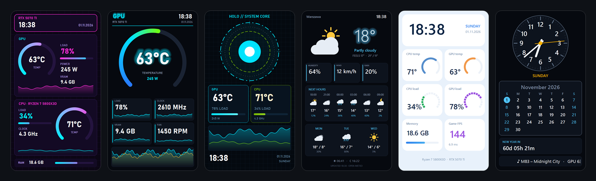
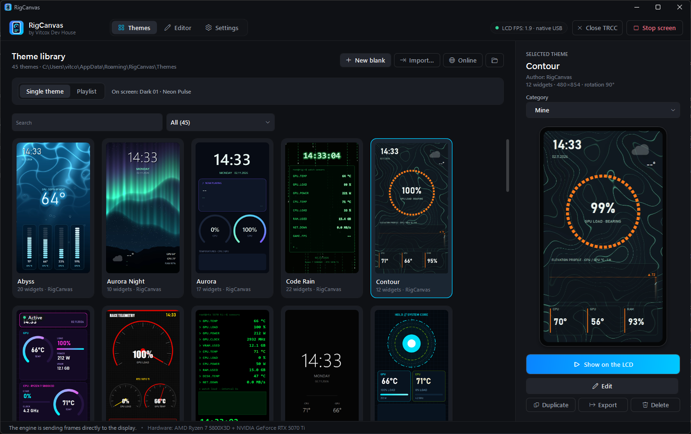
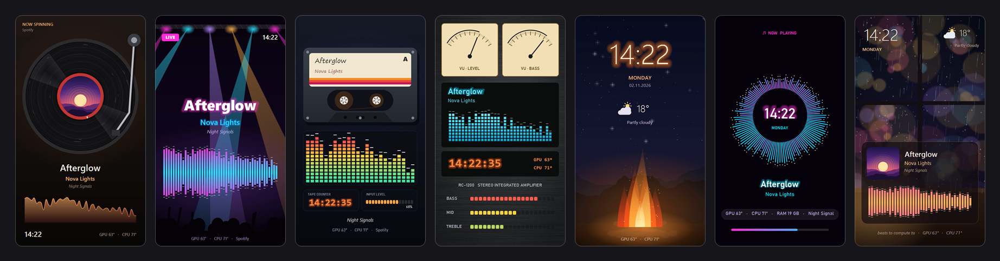
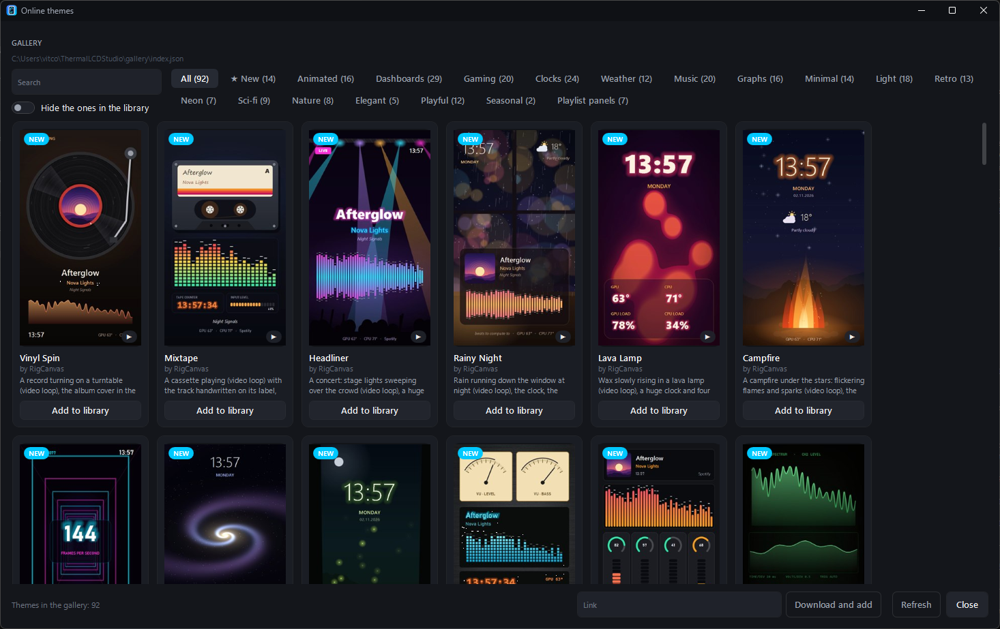
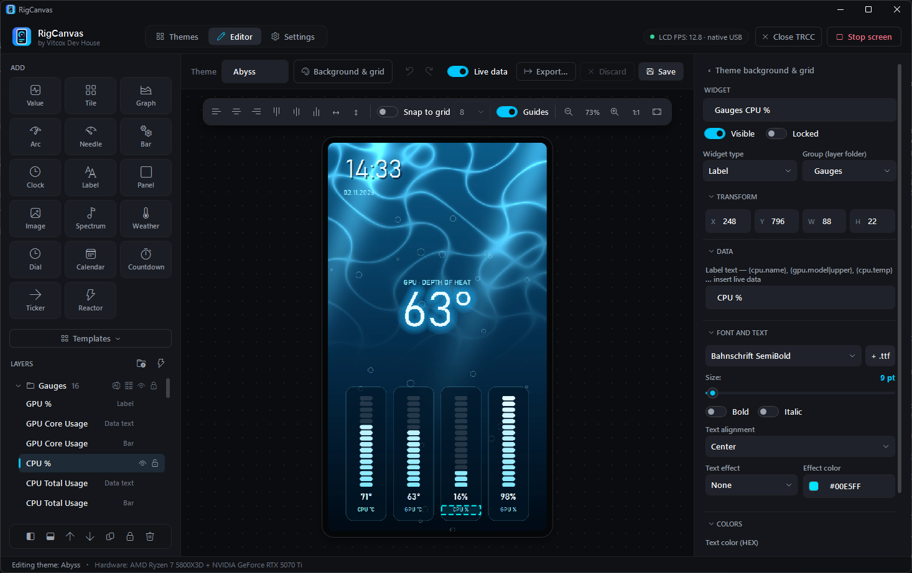
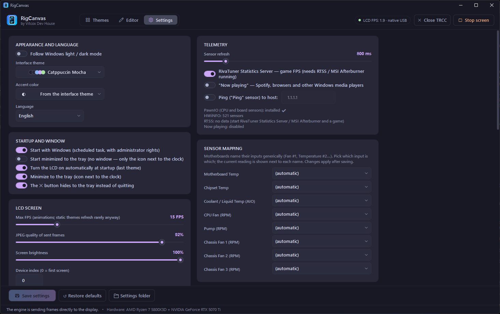

# RigCanvas

**Free Windows app for the 480×854 USB LCD on Thermalright coolers, such as the Peerless Assassin 120 Vision MAX ARGB, and an unofficial alternative to Thermalright's TRCC software.**
It drives the screen directly, with no vendor software, and turns it into your own live dashboard: over 100 themes, a visual editor, live sensors, weather, alerts and more.

[**Download**](https://github.com/vitcox/RigCanvas/releases/latest) · [Features](#features) · [Screenshots](#screenshots) · [Getting started](#getting-started) · [Guides](#guides) · [FAQ](#faq) · [Is it safe?](#is-it-safe) · [Report a problem](https://github.com/vitcox/RigCanvas/issues) · [Polski](README.pl.md)

  

---

## Features

**🎨 Themes**
- 9 built-in themes plus **92 more in the online gallery**, one click away: animated video backgrounds (spinning vinyl, a playing cassette, concert lights, rain, a campfire …), music visualizers, painted art, retro terminals, weather stations, music players, light and dark designs. All of them show *your* hardware names automatically.
- Pictures, animated GIFs and videos as backgrounds, cropped and converted once so playback stays light.
- **Playlists** that rotate themes with a cross-fade.
- **Automatic theme:** switch to a music, game or night theme while something is going on (music playing, a game running, a time window, a sensor above or below a limit, an alert).
- Share themes as `.tlcd` packages (layout, images, fonts) or install them from the online gallery.

**🛠 Visual editor**
- Drag and drop on a live preview, with snapping guides, a grid, alignment tools and zoom.
- Widgets: values, tiles with sparklines, graphs from 30 s up to 24 h, arc / LED / needle gauges, bars, analog clock, calendar, countdown, scrolling ticker, audio spectrum, album art, weather icons, panels, pictures.
- Color thresholds and color scales, glow and shadow effects, custom fonts, smooth value animations.
- Layer folders, undo / redo, copy and paste between themes, reusable widget templates.

**📊 Data**
- CPU and GPU temperature, load, power and clocks; fans, pump, coolant, RAM, disks, network.
- Every raw sensor LibreHardwareMonitor sees, with an easy mapping for board-specific fans.
- Game FPS (RivaTuner Statistics Server), now playing (Spotify, browsers, any Windows player), weather (Open-Meteo, no account).

**⚙ Everyday use**
- Alerts on the LCD and as a Windows notification (GPU too hot, pump stopped…).
- Brightness, automatic night dimming, screen off when the PC is locked or asleep.
- Tray icon, start with Windows, built-in updates, first-start wizard.
- English and Polish; 13 interface themes (Catppuccin, Nord, Dracula, Tokyo Night, Gruvbox, Rosé Pine, Solarized …), any accent color, following Windows light / dark mode if you like.

## Screenshots

**Theme library:** live thumbnails, search and categories, one click to put a theme on the screen.

**Online gallery:** 92 more themes, filtered by tags (animated, gaming, weather, music, light …) and added with one click (Themes tab → **Online**).

New themes are marked and listed first; animated ones play a preview when you point at them.

**Editor:** drag widgets on a live preview; every property in the inspector on the right.

**Settings:** screen, sensors, startup, weather, alerts and automatic theme switching. The app itself comes in 13 interface themes (here Catppuccin Mocha), with any accent color, and can follow Windows light / dark mode.

## Getting started

### Requirements
- Windows 10 or 11, 64-bit.
- A Thermalright cooler with the 480×854 USB LCD (USB ID `87AD:70DB`). Tested on the **Thermalright Peerless Assassin 120 Vision MAX ARGB**; other coolers with the same screen should work too.
- Recommended: the free **[PawnIO](https://pawnio.eu/)** driver (`winget install namazso.PawnIO`). Without it the CPU temperature / power and motherboard fans can't be read. It's a separate project, so it isn't bundled; setup offers the download page if it's missing.
- Optional: [RivaTuner Statistics Server](https://www.guru3d.com/download/rtss-rivatuner-statistics-server-download/) (comes with MSI Afterburner) for game FPS.
- Thermalright TRCC is **not** needed. If it's installed, close it: only one program can drive the screen.

### Install
1. Download `RigCanvas-Setup-x.y.z.exe` from [Releases](https://github.com/vitcox/RigCanvas/releases/latest).
2. Run it. Everything it needs is included; no .NET install required.
3. The first-start wizard checks the screen and PawnIO and lets you pick a theme.

The app runs with administrator rights, because hardware sensors and the USB screen need them. Windows asks once at startup; "start with Windows" uses a scheduled task, so it doesn't ask at every logon.

### Uninstall
**Windows Settings → Apps → RigCanvas → Uninstall.** The uninstaller asks whether to keep your settings and themes (`%AppData%\RigCanvas`).

## Guides

| Guide | What's in it |
|---|---|
| [User guide](docs/user-guide.md) | Themes and categories, playlists, automatic theme, alerts, weather, brightness, startup, updates, backups |
| [Theme guide](docs/themes.md) | The editor step by step: widgets, placeholders, colors, fonts, templates, sharing `.tlcd` packages |
| [Sensor reference](docs/sensors.md) | Every sensor key (CPU, GPU, fans, disks, network, games, music, weather) and where it comes from |
| [Troubleshooting](docs/troubleshooting.md) | Blank screen, `--` readings, Windows warnings, missing FPS or weather, starting over |

## FAQ

**Windows SmartScreen says "Windows protected your PC".**
The installer isn't code-signed yet. Click *More info → Run anyway*.

**Smart App Control blocked RigCanvas.**
Smart App Control (Windows 11) blocks apps that aren't code-signed until Microsoft's cloud knows them, and each new version starts again. RigCanvas isn't signed yet; signing is planned. Until then a new version can be blocked for a while after its release. It isn't malware: every release is built automatically from the source by GitHub Actions. Smart App Control has no per-app exception, so you can wait a few days and try again, or turn it off in *Windows Security → App & browser control* (your choice).

**Nothing shows up on the LCD.**
Close TRCC if it runs, then unplug and replug the screen's USB cable; the app reconnects within a few seconds. **Settings → LCD screen** shows the connection state and has a button to open the log.

**CPU temperature shows `--`.**
Install [PawnIO](https://pawnio.eu/) and restart the app. **Settings → Telemetry** shows whether it was found.

**Can it replace TRCC?**
For the screen, yes. RigCanvas drives the LCD on its own, with its own themes, editor and sensors, so TRCC doesn't need to be installed or running. It is unofficial and not made or supported by Thermalright.

**Does it work with other screens?**
Only the 480×854 panel (`87AD:70DB`) is supported for now.

**Where do I get more themes?**
Themes tab → **Online**: the gallery lists every theme with a preview and a description; **Add to library** installs it. A `.tlcd` file from anywhere else can be dropped onto the theme library, or installed from its https link in the same window.

**Where are my themes?**
In `%AppData%\RigCanvas\Themes` (Themes tab → folder button). Share one with **Export** as a `.tlcd` file.

**How do I get my theme into the online gallery?**
Open an [issue](https://github.com/vitcox/RigCanvas/issues) and attach the exported `.tlcd` file.

## Is it safe?

- **Virus scan:** the installer's download link was checked by 93 engines on VirusTotal with no detections ([report](https://www.virustotal.com/gui/url/9405c2ebf468c5af583cd37dd9ad4d8c48f3e9508d06a657ef928ac61e20342c)).
- **Why administrator rights:** reading hardware sensors (LibreHardwareMonitor with the PawnIO driver) and talking to the USB screen both need them. RigCanvas installs no drivers of its own.
- **No telemetry:** nothing about you or your PC is sent anywhere. The app goes online for the update check and the online theme gallery (GitHub), plus weather (Open-Meteo, only the place you typed) and the ping sensor (the host you set) if you turn them on. Nothing else.
- **SmartScreen warning:** the installer isn't code-signed yet, so Windows shows "unknown publisher". That is about the missing certificate, not the contents.

## Support

Check [Troubleshooting](docs/troubleshooting.md) first. Bugs and ideas: [GitHub Issues](https://github.com/vitcox/RigCanvas/issues). Please include the app version (Settings → Updates and about) and, for screen problems, the log (Settings → LCD screen → Open log).

## License

RigCanvas is **freeware**: free for private and commercial use, and you may share the unmodified installer. See [LICENSE.txt](LICENSE.txt) (Polish: [LICENSE.pl.txt](LICENSE.pl.txt)). Third-party components are listed in [THIRD-PARTY-NOTICES.md](THIRD-PARTY-NOTICES.md).

Made by **Vitcox Dev House**. RigCanvas is an independent project and is not affiliated with or endorsed by Thermalright.
