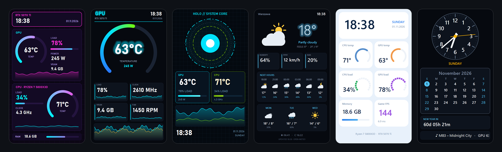
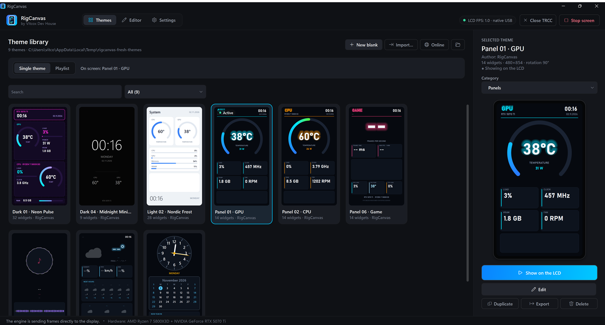
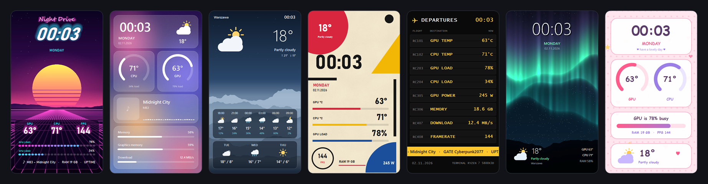
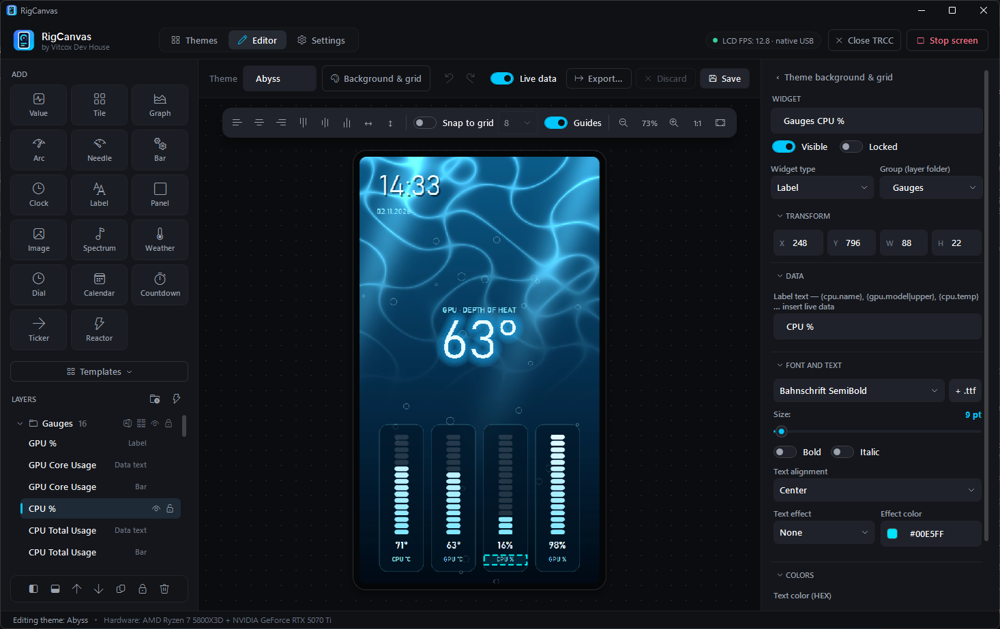
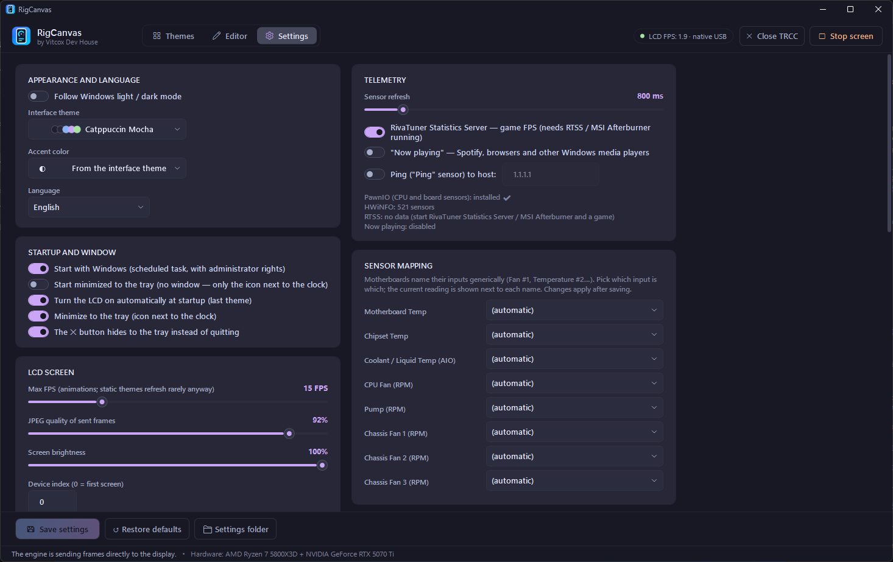

# RigCanvas

**Darmowy program dla Windows do ekranu LCD 480×854 (USB) w chłodzeniach Thermalright, np. Peerless Assassin 120 Vision MAX ARGB. To nieoficjalny zamiennik programu TRCC od Thermalright.**
Obsługuje ekran bezpośrednio, bez oprogramowania producenta, i zamienia go w Twój własny panel na żywo: prawie 90 motywów, edytor wizualny, czujniki, pogoda, alerty i więcej.

[**Pobierz**](https://github.com/vitcox/RigCanvas/releases/latest) · [Funkcje](#funkcje) · [Zrzuty ekranu](#zrzuty-ekranu) · [Pierwsze kroki](#pierwsze-kroki) · [FAQ](#faq) · [Zgłoś problem](https://github.com/vitcox/RigCanvas/issues) · [English](README.md)

  

---

## Funkcje

**🎨 Motywy**
- 9 wbudowanych motywów i **78 kolejnych w galerii online**, jedno kliknięcie dalej: animowane tła wideo, malowane grafiki, retro terminale, stacje pogodowe, odtwarzacze muzyki, jasne i ciemne projekty. Wszystkie same pokazują nazwy *Twojego* sprzętu.
- Obrazy, animowane GIF-y i filmy jako tło, kadrowane i przerabiane raz, więc odtwarzanie jest lekkie.
- **Playlisty** zmieniające motywy z płynnym przejściem.
- **Automatyczna zmiana motywu:** muzyczny, growy albo nocny motyw, gdy coś się dzieje (gra muzyka, uruchomiona gra, przedział godzin, czujnik powyżej lub poniżej progu, alert).
- Udostępnianie motywów jako paczek `.tlcd` (układ, obrazy, czcionki) albo instalacja z galerii online.

**🛠 Edytor wizualny**
- Przeciąganie na podglądzie na żywo, prowadnice, siatka, wyrównywanie i powiększenie.
- Widżety: wartości, kafelki z mini-wykresem, wykresy od 30 s do 24 h, wskaźniki łukowe / LED / ze wskazówką, paski, zegar analogowy, kalendarz, odliczanie, przewijany tekst, spektrum audio, okładka albumu, ikony pogody, panele, obrazy.
- Progi kolorów i skale kolorów, poświata i cień, własne czcionki, płynne animacje wartości.
- Foldery warstw, cofnij / ponów, kopiowanie i wklejanie między motywami, szablony widżetów.

**📊 Dane**
- Temperatura, obciążenie, moc i taktowanie CPU i GPU; wentylatory, pompa, ciecz, RAM, dyski, sieć.
- Każdy czujnik widoczny w LibreHardwareMonitor, z prostym przypisaniem wentylatorów płyty.
- FPS w grach (RivaTuner Statistics Server), „teraz gra” (Spotify, przeglądarki, każdy odtwarzacz Windows), pogoda (Open-Meteo, bez konta).

**⚙ Na co dzień**
- Alerty na ekranie LCD i jako powiadomienie Windows (za gorące GPU, stojąca pompa…).
- Jasność, automatyczne przyciemnianie w nocy, wygaszanie przy zablokowanym lub uśpionym PC.
- Ikona w zasobniku, start z Windows, wbudowane aktualizacje, kreator pierwszego uruchomienia.
- Polski i angielski, interfejs ciemny i jasny.

## Zrzuty ekranu

Program ma polski i angielski interfejs; zrzuty pokazują wersję angielską.

**Biblioteka motywów:** miniatury na żywo, wyszukiwanie i kategorie, motyw na ekran jednym kliknięciem.

**Galeria online:** 78 kolejnych motywów, filtrowanych tagami (animowane, gry, pogoda, muzyka, jasne …) i dodawanych jednym kliknięciem (zakładka Motywy → **Online**).

**Edytor:** przeciąganie widżetów na podglądzie na żywo, wszystkie właściwości w inspektorze po prawej.

**Ustawienia:** ekran, czujniki, uruchamianie, pogoda, alerty i automatyczna zmiana motywu.

## Pierwsze kroki

### Wymagania
- Windows 10 lub 11, 64-bit.
- Chłodzenie Thermalright z ekranem LCD 480×854 na USB (identyfikator `87AD:70DB`). Przetestowane na **Thermalright Peerless Assassin 120 Vision MAX ARGB**; inne chłodzenia z tym samym ekranem też powinny działać.
- Zalecany darmowy sterownik **[PawnIO](https://pawnio.eu/)** (`winget install namazso.PawnIO`). Bez niego nie da się odczytać temperatury i mocy CPU ani wentylatorów płyty. To osobny projekt, więc nie jest dołączony; instalator podpowie stronę pobierania.
- Opcjonalnie: [RivaTuner Statistics Server](https://www.guru3d.com/download/rtss-rivatuner-statistics-server-download/) (jest w MSI Afterburner) dla FPS w grach.
- Program Thermalright TRCC **nie** jest potrzebny. Jeśli jest zainstalowany, zamknij go: ekranem może sterować tylko jeden program.

### Instalacja
1. Pobierz `RigCanvas-Setup-x.y.z.exe` z [Releases](https://github.com/vitcox/RigCanvas/releases/latest).
2. Uruchom go. Wszystko, czego potrzebuje, jest w środku; nie trzeba instalować .NET.
3. Kreator pierwszego uruchomienia sprawdzi ekran i PawnIO i pozwoli wybrać motyw.

Program działa z uprawnieniami administratora, bo wymagają ich czujniki sprzętowe i ekran USB. Windows pyta raz przy starcie; „uruchamiaj razem z Windows” korzysta z zadania harmonogramu, więc nie pyta przy każdym logowaniu.

### Odinstalowanie
**Ustawienia Windows → Aplikacje → RigCanvas → Odinstaluj.** Deinstalator zapyta, czy zachować ustawienia i motywy (`%AppData%\RigCanvas`).

## FAQ

**SmartScreen pokazuje „System Windows ochronił komputer”.**
Instalator nie jest jeszcze podpisany cyfrowo. Kliknij *Więcej informacji → Uruchom mimo to*.

**Na ekranie LCD nic się nie pojawia.**
Zamknij TRCC, jeśli działa, potem odłącz i podłącz kabel USB ekranu; program połączy się ponownie w kilka sekund. **Ustawienia → Ekran LCD** pokazują stan połączenia i mają przycisk otwierający log.

**Temperatura CPU pokazuje `--`.**
Zainstaluj [PawnIO](https://pawnio.eu/) i uruchom program ponownie. **Ustawienia → Telemetria** pokazują, czy został wykryty.

**Czy zastąpi TRCC?**
Jeśli chodzi o ekran, tak. RigCanvas sam obsługuje LCD, ma własne motywy, edytor i czujniki, więc TRCC nie musi być zainstalowany ani uruchomiony. To program nieoficjalny, nietworzony ani niewspierany przez Thermalright.

**Czy działa z innymi ekranami?**
Na razie obsługiwany jest tylko panel 480×854 (`87AD:70DB`).

**Skąd wziąć więcej motywów?**
Zakładka Motywy → **Online**: galeria pokazuje każdy motyw z podglądem i opisem, a **Dodaj do biblioteki** go instaluje. Plik `.tlcd` z innego miejsca można przeciągnąć na bibliotekę motywów albo zainstalować z linku https w tym samym oknie.

**Gdzie są moje motywy?**
W `%AppData%\RigCanvas\Themes` (zakładka Motywy → przycisk folderu). Motyw udostępnisz przyciskiem **Eksport** jako plik `.tlcd`.

**Jak dodać mój motyw do galerii online?**
Otwórz [zgłoszenie](https://github.com/vitcox/RigCanvas/issues) i dołącz wyeksportowany plik `.tlcd`.

## Wsparcie

Błędy i pomysły: [GitHub Issues](https://github.com/vitcox/RigCanvas/issues). Podaj wersję programu (Ustawienia → Aktualizacje i informacje), a przy problemach z ekranem dołącz log (Ustawienia → Ekran LCD → Otwórz log).

## Licencja

RigCanvas to **freeware**: darmowy do użytku prywatnego i komercyjnego, niezmieniony instalator można przekazywać dalej. Szczegóły w [LICENSE.pl.txt](LICENSE.pl.txt) (wiążąca wersja angielska: [LICENSE.txt](LICENSE.txt)). Składniki innych firm są wymienione w [THIRD-PARTY-NOTICES.md](THIRD-PARTY-NOTICES.md).

Stworzone przez **Vitcox Dev House**. RigCanvas jest niezależnym projektem, niepowiązanym z firmą Thermalright.
