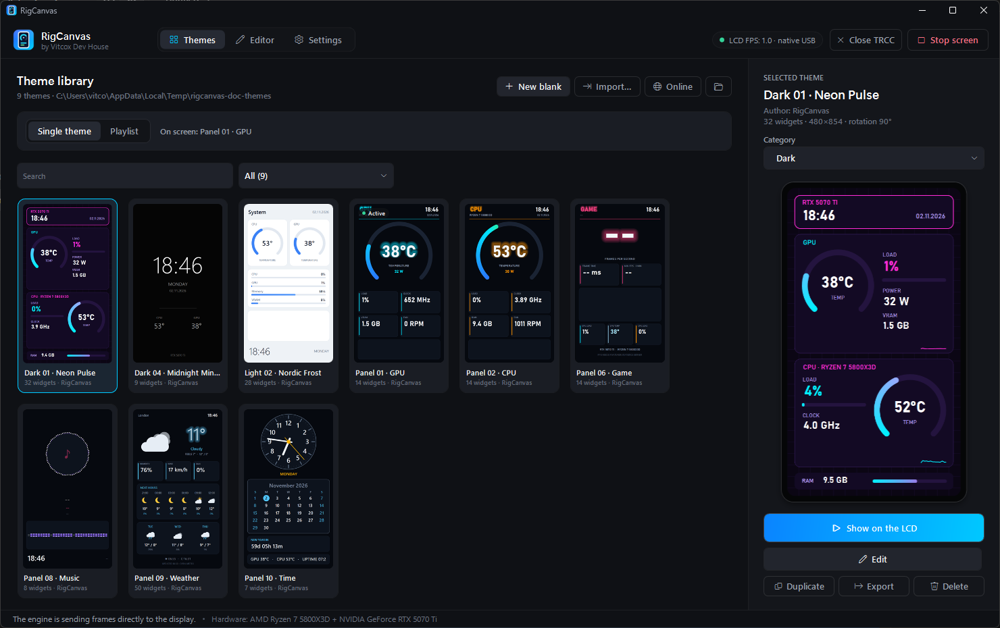

# RigCanvas documentation

[← Back to the project page](../README.md)

RigCanvas turns the 480×854 USB screen on Thermalright coolers into a live dashboard: themes, sensors, music, weather and alerts, all free. These guides take you from the first start to building your own themes.

| Guide | Read it when you want to … |
|---|---|
| **[Getting started](getting-started.md)** | install RigCanvas, go through the first-start wizard and put a theme on the screen |
| **[User guide](user-guide.md)** | find themes, build playlists, switch themes automatically, set up alerts, weather, shortcuts, the look of the app |
| **[Theme editor guide](themes.md)** | change a theme or build your own: every widget, colors, conditions, fonts, sharing |
| **[Sensor reference](sensors.md)** | look up a sensor key, or point a widget at the right fan or temperature on your board |
| **[Troubleshooting](troubleshooting.md)** | fix a blank screen, `--` readings, Windows warnings, missing weather or FPS |

## The three tabs at a glance

- **Themes:** your library. Pick what the screen shows, search and sort, get more themes **Online**, or let a **Playlist** rotate them.
- **Editor:** change the selected theme on a live preview. Everything you do shows on the LCD right away.
- **Settings:** the screen, sensors, weather, alerts, automatic themes, shortcuts, the look of the app and updates.

The chip at the top right shows whether the screen is running (`LCD FPS: … · native USB`), and **Start LCD screen / Stop screen** next to it switches it on and off.

## Need help?

Check [Troubleshooting](troubleshooting.md) first. Bugs and ideas: [GitHub Issues](https://github.com/vitcox/RigCanvas/issues). Please include the app version (**Settings → Updates and about**) and, for screen problems, the log (**Settings → LCD screen → Open log**).
