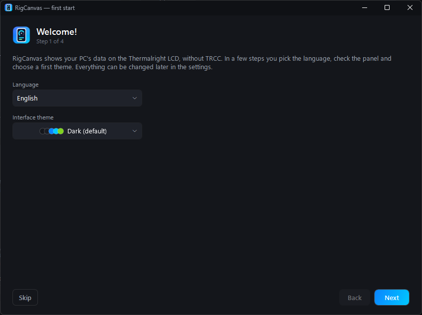
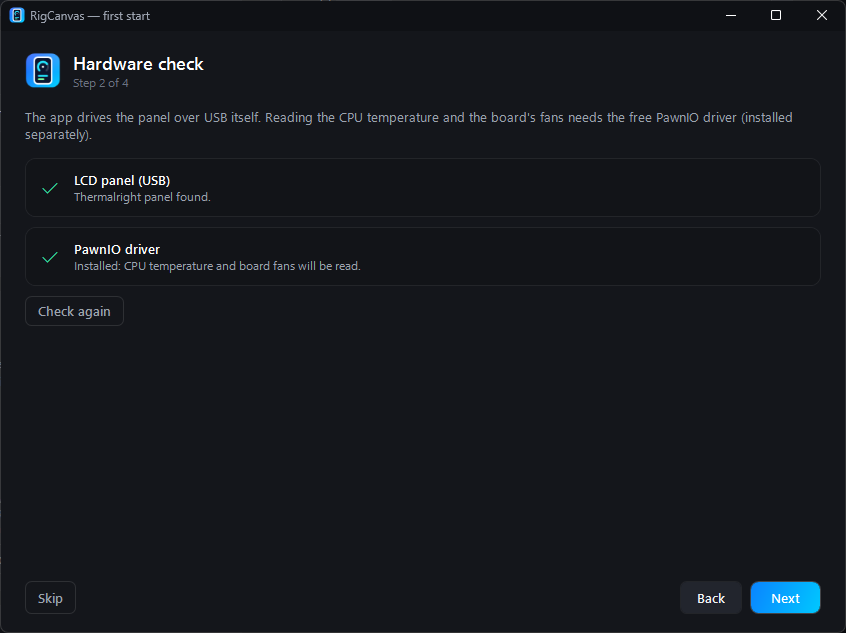
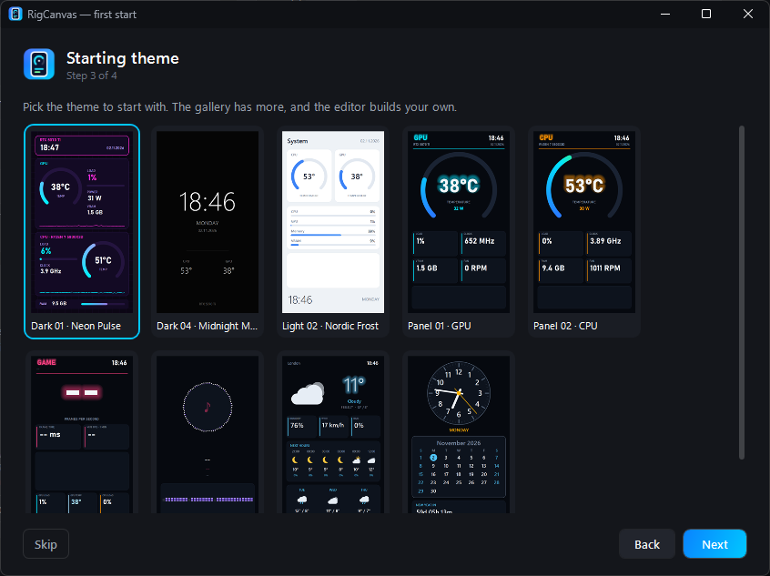
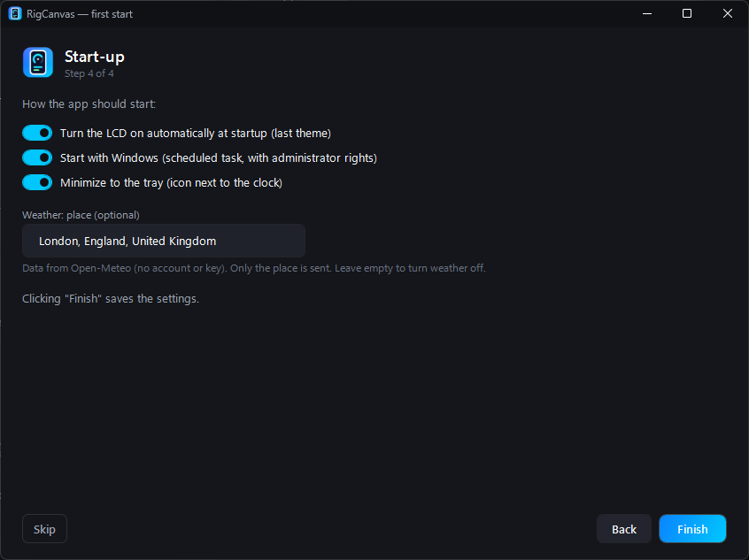
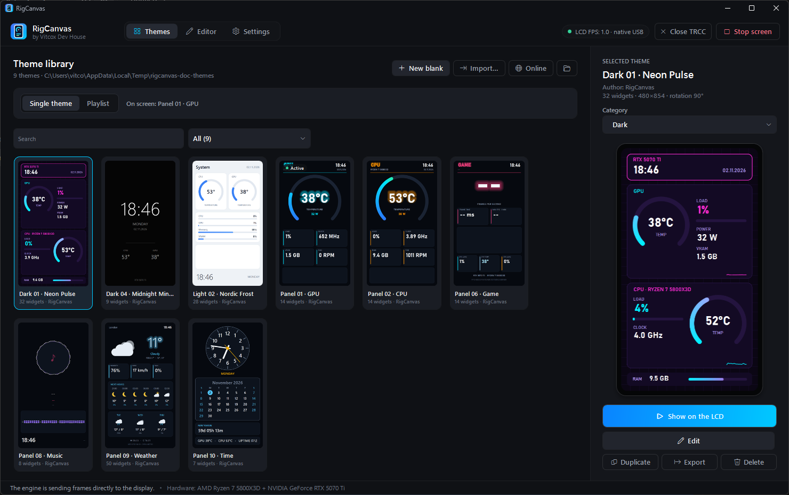

# Getting started

[← Documentation](README.md) · [User guide](user-guide.md) · [Theme editor guide](themes.md) · [Sensor reference](sensors.md) · [Troubleshooting](troubleshooting.md)

From download to a live theme on your cooler's screen in about five minutes.

## 1. What you need

| | |
|---|---|
| **Windows** | 10 or 11, 64-bit |
| **Screen** | A Thermalright cooler with the 480×854 USB LCD (USB ID `87AD:70DB`), e.g. the Peerless Assassin 120 Vision MAX ARGB. Its USB cable goes to an internal USB header on the motherboard. |
| **PawnIO** (recommended) | A free driver that lets the app read the CPU temperature and power and the motherboard fans: `winget install namazso.PawnIO` or [pawnio.eu](https://pawnio.eu/). Without it those readings show `--`. |
| **RivaTuner Statistics Server** (optional) | Only for game FPS. It comes with MSI Afterburner. |

You **don't** need Thermalright's TRCC. If it's installed, close it: only one program can drive the screen.

## 2. Install

1. Download `RigCanvas-Setup-x.y.z.exe` from the [latest release](https://github.com/vitcox/RigCanvas/releases/latest).
2. Run it. Everything the app needs is included; no .NET install is required.
3. Windows may warn you, because the app isn't code-signed yet:
   - **SmartScreen** ("Windows protected your PC"): click **More info → Run anyway**.
   - **Smart App Control** (Windows 11) may block a brand-new version for a few days. See [Troubleshooting](troubleshooting.md#windows-blocks-the-installer-or-the-app).
4. The app asks for administrator rights when it starts: hardware sensors and the USB screen need them. With **Start with Windows** on, it starts through a scheduled task and doesn't ask again at every logon.

## 3. The first-start wizard

The first time RigCanvas starts, a short wizard sets it up. **Skip** keeps the defaults; everything can be changed later in **Settings**, and **Settings → Updates and about → Setup wizard…** runs it again.

| | |
|---|---|
|  | **Step 1 · Welcome.** Pick the language (English or Polski) and the interface theme. The window changes as you choose. |
|  | **Step 2 · Hardware check.** A tick means the screen and PawnIO were found. If the screen is missing, check its USB cable and click **Check again**; if PawnIO is missing, the **pawnio.eu** button opens its download page: install it, then restart the app. |
|  | **Step 3 · Starting theme.** Click the theme to start with. There are more in the library and the online gallery. |
|  | **Step 4 · Start-up.** Whether the LCD turns on by itself, the app starts with Windows and hides in the tray, and an optional place for the weather. **Finish** saves it all. |

## 4. Put a theme on the screen

1. Open the **Themes** tab and click a theme. The large preview on the right shows it with your live data.
2. Click **Show on the LCD** (or double-click the card). The screen switches within a second.
3. The chip at the top right now shows `LCD FPS: … · native USB`: the app talks to the screen directly.

**Nothing on the screen?** Close TRCC if it runs (**Close TRCC** at the top does it), then unplug and replug the screen's USB cable. More in [Troubleshooting](troubleshooting.md#nothing-appears-on-the-lcd).

## 5. Where to go next

- **More themes:** **Online** opens a gallery of 90+ themes with moving and musical ones; one click adds a theme. [More](user-guide.md#the-online-gallery)
- **Rotate themes:** switch the library to **Playlist**. [More](user-guide.md#playlists)
- **Make it yours:** **Edit** opens the theme in the editor. [Theme editor guide](themes.md)
- **Weather, alerts, automatic themes, shortcuts:** see the [User guide](user-guide.md).

### Living in the tray

With **Minimize to the tray** on, minimizing hides the window in the tray; with **The ✕ button hides to the tray**, so does closing it. The screen keeps running either way. The tray icon's menu shows the window, starts or stops the screen, jumps to the next playlist theme and exits the app. Double-click the icon, or start the app again, to bring the window back.
