# Theme editor guide

[← Documentation](README.md) · [Getting started](getting-started.md) · [User guide](user-guide.md) · [Sensor reference](sensors.md) · [Troubleshooting](troubleshooting.md)

Change any theme or build your own. Everything you do shows in the preview and, while the screen runs, on the LCD itself.

**Contents:** [A tour of the editor](#a-tour-of-the-editor) · [Your first theme](#your-first-theme-in-five-minutes) · [Widgets](#widgets) · [The inspector](#the-inspector) · [Colors that follow the value](#colors-that-follow-the-value) · [Showing a widget only sometimes](#showing-a-widget-only-sometimes) · [Theme options](#theme-options) · [Placeholders](#placeholders) · [Templates and groups](#templates-and-groups) · [Fonts](#fonts) · [Sharing themes](#sharing-themes) · [Tips](#tips)

---

## A tour of the editor

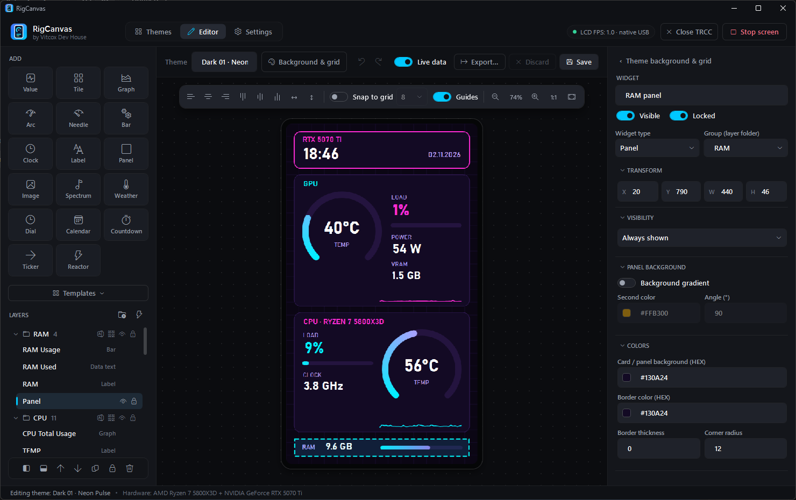

| Area | What it does |
|---|---|
| **Add** (left) | One button per widget type. A new widget appears near the top left and joins the group you're working in. **Templates** below inserts ready-made blocks. |
| **Layers** (left, below) | Every widget, top of the list = drawn on top. Folders are [groups](#templates-and-groups); the eye and lock icons hide or lock a widget or a whole group. The buttons underneath move, duplicate, lock and delete the selection. |
| **Top bar** | The theme's name, **Background & grid** (the [theme options](#theme-options)), undo / redo, **Live data**, **Export…**, **Discard** and **Save**. |
| **Canvas** (middle) | The 480 × 854 preview. Drag widgets to move them; set their size in the inspector (**Transform**). The floating toolbar aligns and spaces the selection, sets **Snap to grid** and **Guides**, and zooms. |
| **Inspector** (right) | Every property of the selected widget, in collapsible sections. With nothing selected it edits the theme itself. |

- **Live data** keeps the preview following your sensors; switch it off to freeze the picture while you arrange things.
- The dot on **Save** means unsaved changes. **Discard** goes back to the last save (one Ctrl+Z brings the edits back). Leaving the editor or closing the app with unsaved changes asks what to do.

### Keyboard and mouse

| Action | How |
|---|---|
| Select several | Ctrl+click or Shift+click; Ctrl+A selects all; clicking a group in the layer list selects the whole group |
| Move by 1 px / 10 px | Arrow keys / Shift + arrow keys |
| Snap | **Guides** snap to the edges and centers of other widgets (hold Alt to move freely); **Snap to grid** snaps to a 2–20 px grid shown on the preview |
| Zoom and pan | Ctrl + mouse wheel; drag with the right or middle mouse button to pan |
| Duplicate, delete | Ctrl+D, Delete |
| Lock / unlock, group | Ctrl+L, Ctrl+G |
| Copy, cut, paste | Ctrl+C, Ctrl+X, Ctrl+V (also between themes) |
| Undo, redo, save | Ctrl+Z, Ctrl+Y, Ctrl+S |
| Deselect | Esc (the inspector then edits the [theme itself](#theme-options)) |

---

## Your first theme in five minutes

1. **Start from something close.** In the **Themes** tab select a theme and click **Duplicate**, or **New blank** for an empty one. Then **Edit**.
2. **Set the background.** Press Esc (nothing selected) and pick a color, or a picture or video, under **Background**.
3. **Add a big number.** Click **Value** in the Add panel. In the inspector, under **Data**, pick the sensor (e.g. *GPU Core Temp*) and type `°C` as the suffix. Under **Font and text**, raise the size.
4. **Add context.** A **Label** with `GPU` above it, a **Graph** of the same sensor below it, a **Panel** behind them as a card (a new panel goes to the bottom of the layers and is locked, so clicks reach the widgets on top).
5. **Make it react.** On the value, open **Color thresholds** and turn on **Change color based on the sensor value** (warning from 75, critical from 85), so it turns amber and red when hot.
6. **Save** (Ctrl+S). The theme is in your library; a new blank one is listed under **Mine**, a duplicate next to its original. Give it its own name in the top bar and, if you like, its own **Category**.

---

## Widgets

Each widget type with an example, made with the app's own renderer.

| Widget | | What it shows · key properties |
|---|---|---|
| **Value** (data text) | 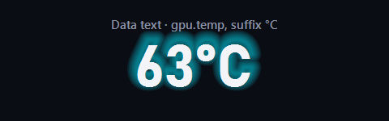 | One sensor reading. Sensor, number format, prefix / suffix, [colors that follow the value](#colors-that-follow-the-value). |
| **Label** | 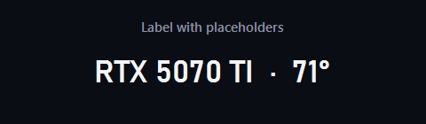 | Fixed text with [placeholders](#placeholders) for live values and hardware names. |
| **Clock** | 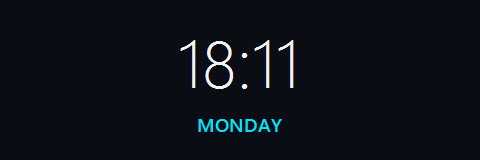 | Time, short time, date or weekday (`clock.time`, `clock.time.short`, `clock.date`, `clock.day`). |
| **Tile** (sensor tile) | 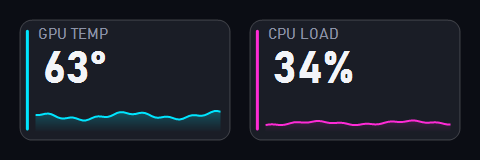 | A card: label, big value, status stripe and an optional mini graph. |
| **Bar** | 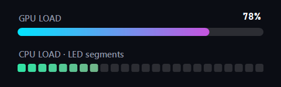 | A progress bar: min / max, start and end color, track, vertical, LED segments. |
| **Arc / Needle** (gauge) | 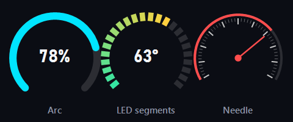 | Round gauges in three styles: arc, LED segments, needle. Start angle, sweep, thickness, segments. |
| **Graph** | 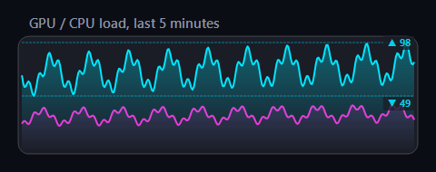 | History from 30 s to 24 h, filled line or bars, optional second series, min / max markers, auto scale. |
| **Panel** | 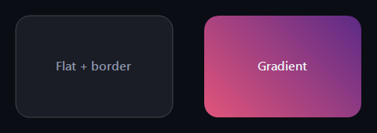 | A background card: flat or gradient fill, border, rounded corners. |
| **Image** | 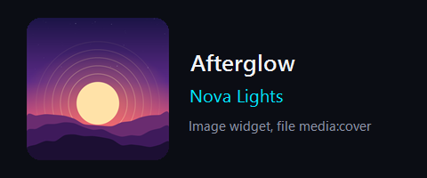 | A picture, animated GIF or video; the file `media:cover` shows the album art of what's playing. |
| **Spectrum** | 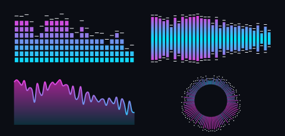 | The PC's sound, live: bars, mirror, wave or circle; bands, LED segments, falling peaks. |
| **Weather** (icon) | 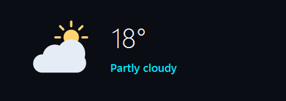 | A drawn weather symbol for a `weather.*code` sensor, day and night, with your colors. |
| **Dial** (analog clock) | 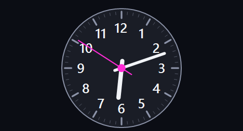 | An analog clock: seconds hand, numbers, colors. |
| **Calendar** | 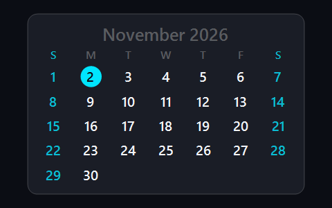 | This month with today marked. |
| **Countdown** | 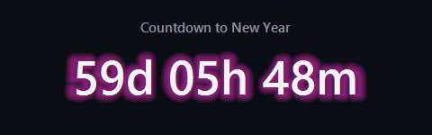 | Time left until a date: `yyyy-MM-dd [HH:mm]`, or `MM-dd` for every year. Days + hours + minutes, days, or a clock. |
| **Ticker** | 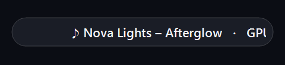 | Text with placeholders that scrolls sideways when it doesn't fit; speed in px/s. |
| **Reactor** | 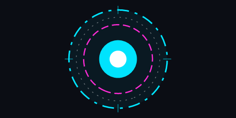 | Animated sci-fi rings, outer and inner color. |

**Gauge angles** are in degrees, clockwise from 3 o'clock. Common setups: **270°** (start 135), **240° speedometer** (start 150), **180° half circle** (start 180), **360°** (start 270).

**Graph windows** up to 5 minutes use live samples. Longer windows (15 min, 1 h, 6 h, 24 h) show one average per minute, kept across restarts, so a 24-hour graph is full the next day too.

The spectrum only listens while a theme on the screen has one; nothing is recorded.

---

## The inspector

The inspector groups a widget's properties in sections; only the ones that apply to its type are shown.

| Section | What's in it |
|---|---|
| **Widget** | Name, **Visible**, **Locked**, **Widget type** (change it without starting over) and **Group** |
| **Transform** | X, Y, width and height in screen pixels; decimals are kept |
| **Visibility** | [Show the widget only sometimes](#showing-a-widget-only-sometimes) |
| **Data** | The sensor, label text, prefix / suffix and number format |
| Gauge, Graph, Bar, Spectrum, Options | The settings of that widget type |
| **Font and text** | Font, size, bold / italic, alignment, **Text effect** (glow or shadow) and its color |
| **Colors** | Text, accent, background and border colors, border thickness, corner radius |
| **Value range**, **Color by value**, **Color thresholds** | The [colors that follow the value](#colors-that-follow-the-value) |

Colors are `#RRGGBB` or `#AARRGGBB` (the first pair is opacity); the swatch next to each field shows the color, and an invalid value is marked red. **Number format** uses .NET format strings: `{0:F0}` → `57`, `{0:F1}` → `57.3`, `{0:F2}` → `4.35`.

---

## Colors that follow the value

Values, bars, gauges, tiles and graphs can change color with the reading, in one of two ways.

### Color thresholds

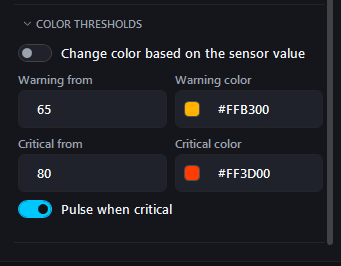

| Value | Color |
|---|---|
| more than 5 below **Warning from** | the normal color (thresholds on: **Change color based on the sensor value**) |
| the last 5 before **Warning from** | a smooth blend into the warning color |
| from **Warning from** | **Warning color** |
| from **Critical from** | **Critical color**, optionally **Pulse when critical** |

Typical limits: CPU 75 / 88 °C, GPU 72 / 84 °C. LED-segment gauges color each segment by the value it stands for: the classic green → amber → red speedometer.

<br clear="right">

### Color by value (color scale)

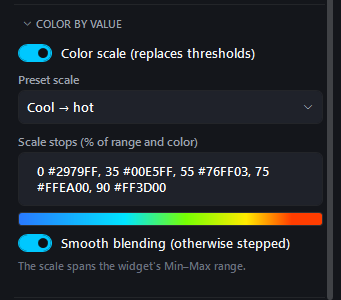

A scale with any number of stops, in % of the widget's **Min**–**Max** (**Value range** section): `0 #2979FF, 60 #FFEA00, 90 #FF3D00`. **Preset scale** offers ready ones (cool → hot, green → red, rainbow, fire, ice, neon, toxic).

- **Smooth blending** fades between stops; off, the color steps.
- **Gradient along the bar / arc:** on, the whole scale is laid out along the track like a tachometer; off, the whole bar takes the color of the current value.
- LED gauges color each segment by its value, graphs color the line by its height.
- A color scale replaces thresholds.

<br clear="right">

---

## Showing a widget only sometimes

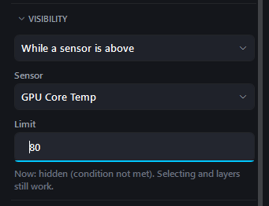

The **Visibility** section hides a widget until a condition is met, on the LCD and in the preview:

| Condition | Example |
|---|---|
| While a sensor is above / below | A red "HOT" panel while `gpu.temp` is above 85 |
| While a sensor has a reading | An FPS card only while a game runs (`game.fps`), a music card only while something plays (`media.title`) |
| While a sensor has no reading | A big clock that fills the space when no game runs |

Choosing a condition starts from the widget's own sensor; pick another under **Sensor**. Put two widgets in the same place with opposite conditions and they take turns. A hidden widget stays selectable in the layer list, and the section says whether it shows right now.

<br clear="right">

---

## Theme options

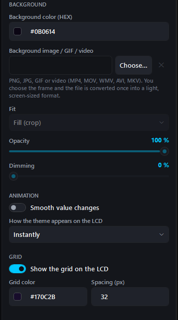

Press Esc (or **Background & grid**) and the inspector edits the theme itself:

- **Background:** a color, plus an optional picture, GIF or video (MP4, MOV, WMV, AVI, MKV). When you pick a file you choose the crop, rotation and frame rate once; it is converted to the screen size, so playback stays light. **Fit**, **Opacity** and **Dimming** keep the data readable on top.
- **Smooth value changes:** bars, gauges and numbers glide to new readings (extra frames are drawn only while something moves).
- **How the theme appears on the LCD:** instantly, fading in from black, or revealed from the top.
- **Grid:** a decorative grid drawn on the LCD, with its own color and spacing. Not to be confused with the editor's **Snap to grid**, which is never sent to the screen.

<br clear="right">

---

## Placeholders

Label and ticker text can contain `{sensor.key}` tokens, replaced with live values:

```
{gpu.name}            NVIDIA GeForce RTX 5070 Ti
{gpu.model|upper}     RTX 5070 TI
{cpu.model}           Ryzen 7 5800X3D
CPU {cpu.temp}°C      CPU 57°C
{media.artist} – {media.title}
```

- Modifiers: `|upper`, `|lower`.
- Any key from the [sensor reference](sensors.md) works, raw keys included: `{lhm:Nuvoton NCT6798D/Fan/Fan #3}`, `{hwi:CPU Package Power}`.
- A known sensor without a reading right now (no game running, nothing playing) shows `--`. Braces that aren't a sensor key stay as typed, so typos are easy to spot.
- In a **ticker**, separate parts with `·`. A part whose placeholders are all empty is skipped: `♪ {media.artist} – {media.title}  ·  GPU {gpu.temp}°C` shows only the GPU part while nothing plays.

> **Never type your own hardware model into a label.** Use `{cpu.model}` / `{gpu.model}` so the theme looks right on everyone's PC.

---

## Templates and groups

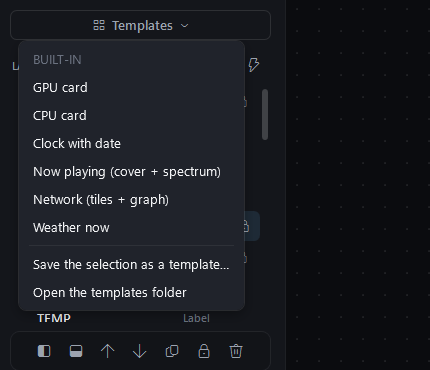

**Templates** (under the Add buttons) inserts ready-made blocks: GPU card, CPU card, clock with date, now playing (cover + spectrum), network (tiles + graph), weather now. To make your own, select some widgets and choose **Save the selection as a template…**; **Open the templates folder** shows where they're kept. An inserted block arrives as its own group.

A **group** is a folder in the layer list. Set it with the **Group** field (it applies to every selected widget) or Ctrl+G. A group can be selected, hidden or locked in one click. **✨ Auto** groups widgets by the first word of their name (`GPU …`, `CPU …`).

<br clear="right">

---

## Fonts

Any installed font works, but for themes you share, stick to fonts that ship with Windows 10 and 11: Segoe UI (Light, Semilight, Semibold, Black), Bahnschrift (Light, SemiLight, SemiBold, Condensed), Consolas, Lucida Console, Georgia, Palatino Linotype, Constantia, Candara, Corbel, Trebuchet MS, Impact, Arial Black, Courier New.

For anything else, click **+ .ttf** next to the font picker. The font (`.ttf` or `.otf`) is copied into the library and packed into `.tlcd` exports, so it shows up on other PCs too.

---

## Sharing themes

**Export** (in the Themes tab or the editor) saves a `.tlcd` package, a zip with:

```
theme.json        the layout; picture paths rewritten to "assets/…"
assets/…          every picture, GIF and video the theme uses
fonts/…           custom fonts the theme uses
thumbnail.png     240 × 427 preview
```

To install one, drop it onto the theme library, use **Import…**, or paste its https link in the **Online** window. Pictures, videos and fonts go into the library's `assets/` and `fonts/` folders. Choosing `.lcdtheme` when exporting saves just the layout, without pictures or fonts.

**Want your theme in the online gallery?** Open an [issue](https://github.com/vitcox/RigCanvas/issues) and attach the `.tlcd` file.

### Where themes live

`%AppData%\RigCanvas\Themes` by default (**Settings → Paths → Theme library**):

```
*.lcdtheme   your themes and the built-in ones
fonts/       custom fonts
assets/      pictures and videos
_legacy/     built-in themes replaced by a newer version (kept, not loaded)
```

Built-in themes are installed once, by the app version that adds or changes them. If you delete one, it stays deleted.

---

## Tips

- **Duplicate** a built-in theme before changing it a lot.
- Use placeholders and the built-in fonts, and your theme works on any PC.
- Give text room: make a box about 1.7 × the font size tall. Text shrinks to fit its box, so a long value is never cut off.
- Check the theme on the real screen: colors and thin lines look different on the LCD than on a monitor.
- Lock background panels (Ctrl+L) so clicks reach the widgets on top of them.
