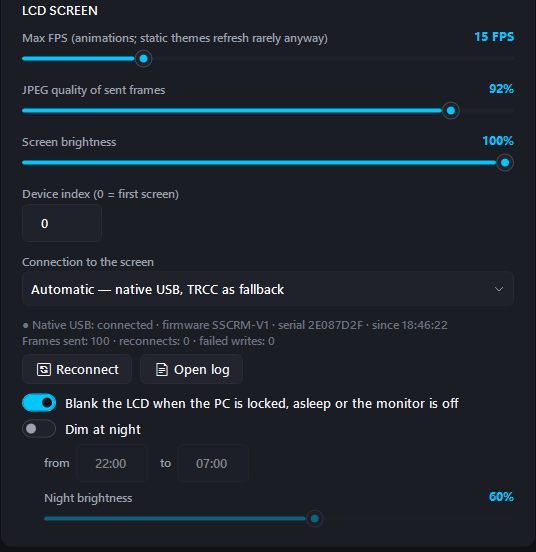

# Troubleshooting

[← Documentation](README.md) · [Getting started](getting-started.md) · [User guide](user-guide.md) · [Theme editor guide](themes.md) · [Sensor reference](sensors.md)

Find your problem below. If it isn't here, see [Reporting a bug](#reporting-a-bug).

- [Windows blocks the installer or the app](#windows-blocks-the-installer-or-the-app)
- [Nothing appears on the LCD](#nothing-appears-on-the-lcd)
- [CPU temperature or fans show `--`](#cpu-temperature-or-fans-show---)
- [GPU 16-pin / PCIe power shows `--`](#gpu-16-pin--pcie-power-shows---)
- [Game FPS is empty](#game-fps-is-empty)
- ["Now playing" is empty](#now-playing-is-empty)
- [Weather doesn't show or shows the wrong place](#weather-doesnt-show-or-shows-the-wrong-place)
- [The window doesn't appear](#the-window-doesnt-appear)
- [A downloaded theme isn't in the library](#a-downloaded-theme-isnt-in-the-library)
- [Start over with default settings](#start-over-with-default-settings)

## Windows blocks the installer or the app
RigCanvas isn't code-signed yet, so Windows doesn't know the publisher.
- **SmartScreen** ("Windows protected your PC"): click *More info → Run anyway*.
- **Smart App Control** (Windows 11) blocks unsigned apps until Microsoft's cloud knows them, and each new version starts again. There's no per-app exception: wait a few days after a release and try again, or turn Smart App Control off in *Windows Security → App & browser control* (your decision).
- **Antivirus:** the app reads hardware sensors with administrator rights, which some scanners flag. It installs no drivers of its own; the installer was checked on VirusTotal with no detections (link in the [README](../README.md#is-it-safe)).

## Nothing appears on the LCD
1. Click **Start LCD screen**. The status bar should show `LCD FPS: … · native USB`.
2. **Close Thermalright's TRCC** if it runs: only one program can drive the screen. RigCanvas closes it when the screen starts, but TRCC can start again with Windows; turn off its autostart.
3. Unplug the screen's USB cable and plug it back in. The app retries every few seconds and picks the screen up on its own.
4. **Settings → LCD screen** shows the connection state (firmware, frames sent, reconnects, the last error) and has **Reconnect** and **Open log** buttons:

   

5. In Device Manager the screen appears under *Universal Serial Bus devices* as `VID_87AD&PID_70DB`, with Windows' built-in WinUSB driver. If it shows with a warning sign, or not at all, check the internal USB cable to the motherboard header.
6. If TRCC is installed, **Settings → LCD screen → Connection to the screen → Through TRCC** is a fallback that sends frames through TRCC's own background program.

## CPU temperature or fans show `--`
CPU temperature / power and motherboard fans need the **PawnIO** driver.
1. Install [PawnIO](https://pawnio.eu/) (or run `winget install namazso.PawnIO`) and restart the app.
2. **Settings → Telemetry** shows whether PawnIO was found ("PawnIO (CPU and board sensors): installed ✓").
3. The app must run as administrator. It asks at startup; if you start it some other way, make sure it's elevated.

Fans other than the CPU fan and the first system fan aren't labelled automatically, because every board names its inputs differently. Assign them in **Settings → Sensor mapping**: each input is listed with its live reading, so you can match it with what the BIOS shows ([details](sensors.md#mapping-board-sensors)).

## GPU 16-pin / PCIe power shows `--`
These two readings exist only in HWiNFO, and only in the copy that ships with Thermalright TRCC. If TRCC is installed, turn on **Settings → TRCC compatibility → Sensors from TRCC's HWiNFO**. The total `gpu.power` works without it.

## Game FPS is empty
Start **RivaTuner Statistics Server** (it comes with MSI Afterburner) before the game, and keep the RivaTuner option on in **Settings → Telemetry**.

## "Now playing" is empty
Only players that show up in Windows' media controls (the media box next to the volume) are supported: Spotify, browsers and most modern players. Check that **"Now playing"** is on in **Settings → Telemetry**.

## Weather doesn't show or shows the wrong place
- In **Settings → Weather**, click **Search** after typing the place and pick the right match: many names exist in several countries. The current weather appears as a check; then click **Save settings**. ([Weather settings](user-guide.md#weather))
- The theme needs weather widgets (e.g. *Panel 09 · Weather*).
- **Settings → Weather** shows the last update or the error. *"Weather error: the weather service is not answering right now (error 503) …"* means Open-Meteo itself is down or busy: nothing to fix on your side. The app keeps showing the last weather it got (up to 12 hours old, also after a restart) and tries again after 30 s, then 1, 2, 4 … up to 15 minutes, so it doesn't flood the service.
- Saving the weather settings asks again right away.

## The window doesn't appear
- With **Start minimized to the tray** on, the app starts as a tray icon only. Double-click the icon, or start the app again: a second start brings up the window of the one already running.
- Only one copy runs at a time; look for the icon in the tray's hidden icons (the ^ arrow).

## A downloaded theme isn't in the library
Themes added from the online gallery, a file or a link are selected in the library right away. If you don't see one, clear the search box and choose **All** in the category list.

## Start over with default settings
1. Exit the app (tray icon → **Exit**).
2. Rename or delete `%AppData%\RigCanvas\settings.json`.
3. Start the app: the first-start wizard runs again, and your themes stay.

To reset everything, themes included, rename the whole `%AppData%\RigCanvas` folder instead. Keep it until you're sure you don't need your themes from it.

## Reporting a bug
Open an [issue](https://github.com/vitcox/RigCanvas/issues/new/choose) and include:
- the app version (**Settings → Updates and about**);
- your cooler, CPU, GPU and motherboard;
- for screen problems, the log (**Settings → LCD screen → Open log**, or `%AppData%\RigCanvas\logs\app.log`);
- for sensor problems, the output of `RigCanvas.exe sensors` (see the [sensor reference](sensors.md#raw-sensors)).
