# User guide

[← Documentation](README.md) · [Getting started](getting-started.md) · [Theme editor guide](themes.md) · [Sensor reference](sensors.md) · [Troubleshooting](troubleshooting.md)

Everything RigCanvas does once it's running. New here? Start with [Getting started](getting-started.md).

**Contents:** [The theme library](#the-theme-library) · [The online gallery](#the-online-gallery) · [Playlists](#playlists) · [Automatic theme](#automatic-theme) · [Alerts](#alerts) · [Weather](#weather) · [The LCD screen](#the-lcd-screen) · [Interface theme and accent color](#interface-theme-and-accent-color) · [Starting with Windows and the tray](#starting-with-windows-and-the-tray) · [Keyboard shortcuts](#keyboard-shortcuts) · [Updates](#updates) · [Your data and backups](#your-data-and-backups)

---

## The theme library

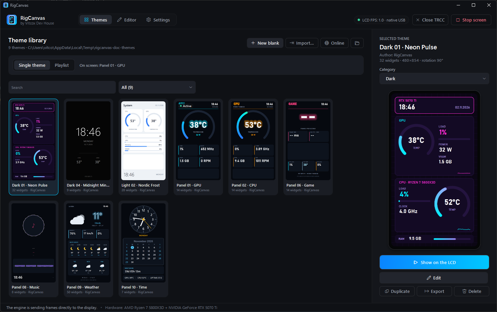

The **Themes** tab is your library. Every card is a live thumbnail with your own readings.

- **Click** a card to see it large on the right; **Show on the LCD** (or a double-click) puts it on the screen.
- **New blank** starts an empty theme, **Import…** adds a `.lcdtheme` or `.tlcd` file (you can also drop files onto the list), **Online** opens the [online gallery](#the-online-gallery), and the folder button opens the library folder.

### Finding a theme

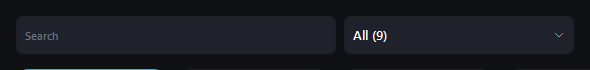

Type in **Search** to filter by name. The list next to it picks a **category**:

| Category | What's in it |
|---|---|
| Dark, Light, Panels, Single value | The built-in groups |
| Mine | Themes you made or added |
| Your own folders | Anything you create (below) |

### Details and actions

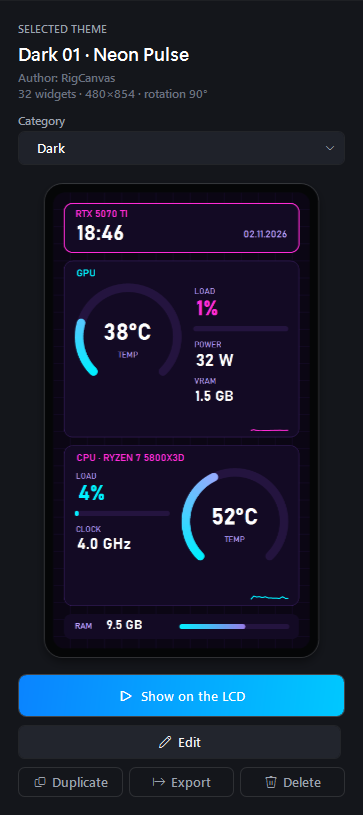

The right column belongs to the selected theme:

- **Category:** pick a group, or **type a new name** to create your own folder and put the theme in it. Folders are kept in the settings; the theme files don't change.
- **Show on the LCD**, **Edit** (opens the [editor](themes.md)), **To playlist**.
- **Duplicate:** make a copy before changing a built-in theme a lot.
- **Export:** save a `.tlcd` package (layout, pictures, fonts) to share.
- **Delete:** removes the theme from the library. A deleted built-in theme stays deleted, even after updates.

 

---

## The online gallery

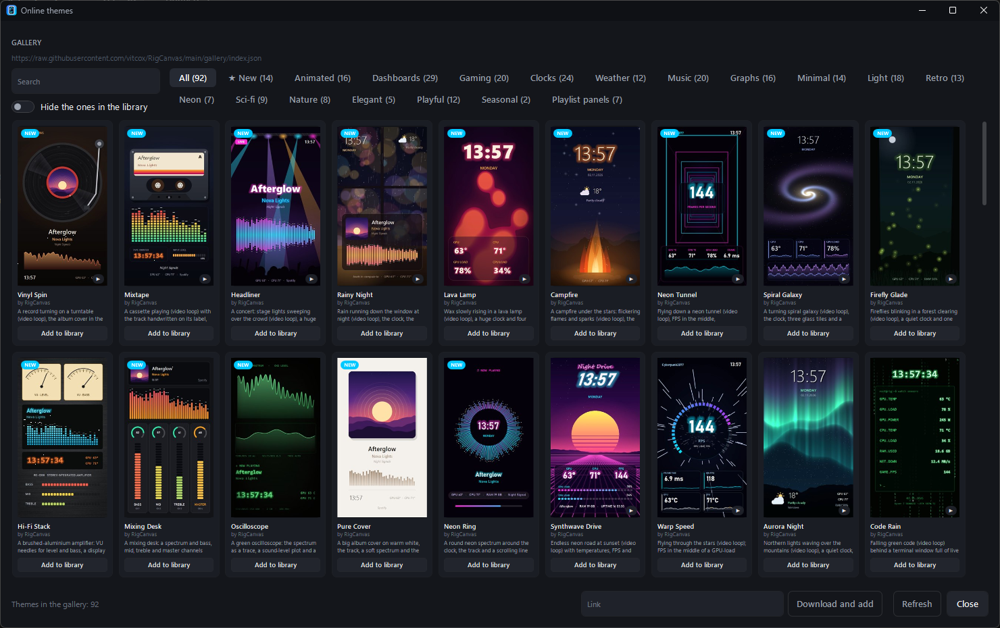

**Online** (Themes tab) lists the community gallery: 90+ themes with video backgrounds, music visualizers, weather stations, retro terminals and more.

- **Filter chips** narrow the list by tag (Animated, Gaming, Clocks, Weather, Music …). **★ New** shows the themes added in the last 30 days; they also come first and carry a **NEW** badge.
- **▶ on a card** means the theme moves: point at the picture to play a short preview.
- **Add to library** downloads the theme and selects it in your library. **Hide the ones in the library** shows only the themes you don't have yet.
- **Link** (at the bottom) installs a `.tlcd` or `.lcdtheme` from any https address, e.g. a file someone shared.

Want your theme in the gallery? Open an [issue](https://github.com/vitcox/RigCanvas/issues) and attach the exported `.tlcd` file.

---

## Playlists

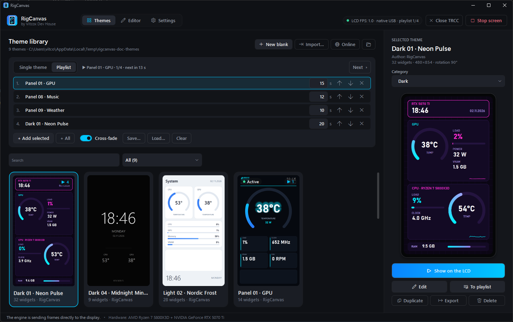

Switch the library from **Single theme** to **Playlist** to rotate several themes on the screen:

1. Select a theme and click **+ Add selected** (or **To playlist** under the preview). **+ All** adds the whole library. A theme may appear more than once.
2. Set how long each one stays (3 to 3600 seconds) and order them with the arrows.
3. **Cross-fade** blends one theme into the next.

The line above the list shows what's on screen and when it changes; **Next ›** skips ahead. **Save…** and **Load…** keep playlists as `.lcdplaylist` files; a few ready-made ones come with the app. Putting a single theme on the screen switches back to **Single theme**.

---

## Automatic theme

> The sections from here on live in the **Settings** tab. Changes there apply when you click **Save settings**; **Discard changes** goes back, and a field with an invalid value is marked red and blocks saving.
>
> 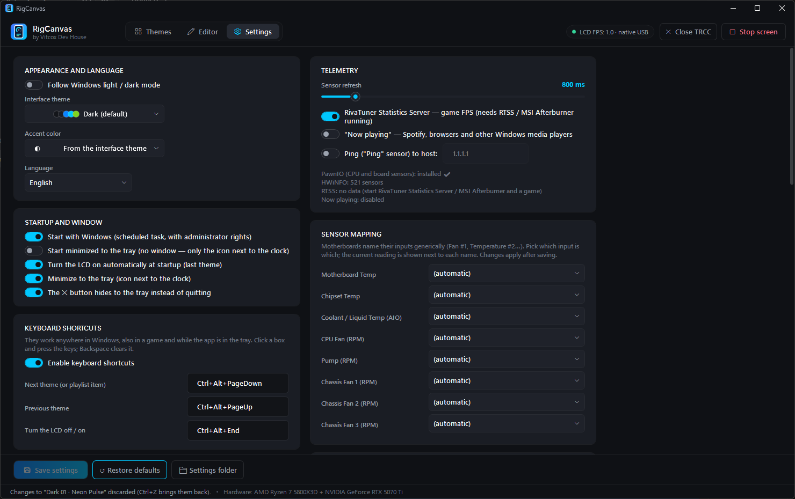

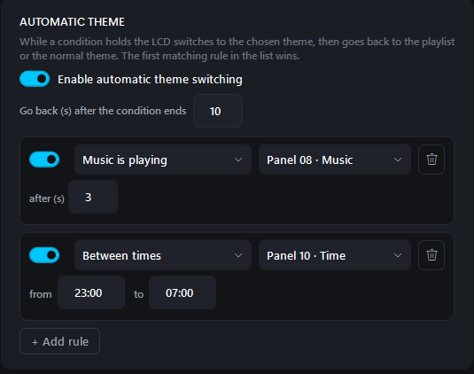

**Settings → Automatic theme** switches the screen to another theme while something is going on, then goes back to the playlist or your normal theme.

Each rule is a **condition** and a **theme**:

| Condition | Typical use |
|---|---|
| Music is playing | A music theme with album art and a spectrum |
| A game is running (RTSS) | A theme with FPS and frame times |
| Between times | A dim clock from 23:00 to 07:00 (the window may pass midnight) |
| Sensor above / Sensor below | A GPU-focused theme while `gpu.load` is above 80 % |
| An alert is active | A full-screen warning theme |

- **after (s):** the condition must hold this long before the theme switches, so a short spike doesn't flip it.
- **Go back (s) after the condition ends:** how long the theme stays afterwards.
- The **first matching rule** wins, so put the important ones on top. Automatic themes win over the playlist and the theme you picked.
- The chip at the top right shows when a rule is in charge.

---

## Alerts

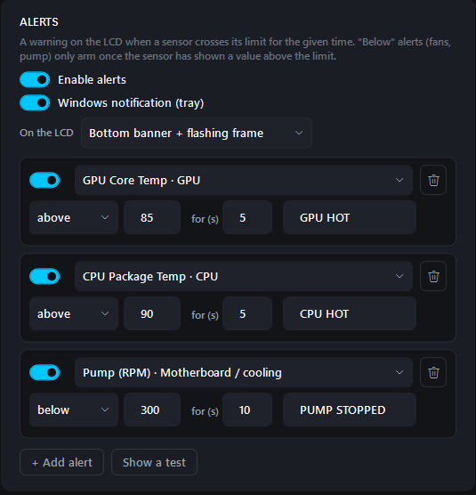

**Settings → Alerts** warns you when a sensor crosses a limit. Three rules come ready: GPU above 85 °C, CPU above 90 °C and a pump below 300 RPM.

- Each rule: a **sensor**, **above** or **below**, a **limit**, **for (s)** (how long it has to stay past the limit, so a single spike doesn't alarm) and the **text on the LCD** (empty uses the sensor's name).
- **Below** rules (fans, pump) arm only after the sensor has been above the limit once, so a fan header with nothing on it never alarms.
- **On the LCD:** a bottom banner with a flashing frame, the full screen, or just the flashing frame.
- **Windows notification (tray)** also pops up a notification on the desktop.
- **Show a test** previews the alert on the screen.

---

## Weather

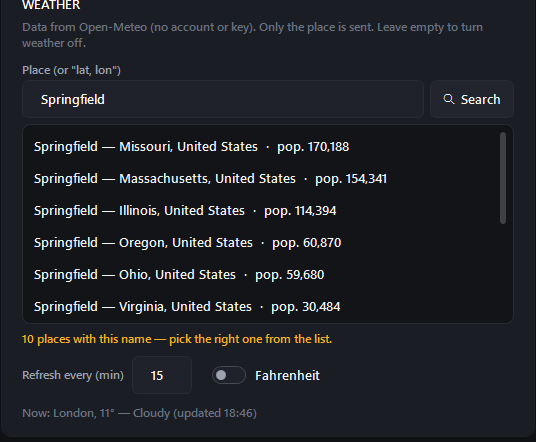

**Settings → Weather** feeds every weather widget: the built-in **Panel 09 · Weather** and the weather themes of the online gallery.

1. Type a place and click **Search** (or press Enter).
2. If several places share the name, pick the right one: the list shows the region, country and population.
3. The current weather appears below as a check. Click **Save settings**.

You can also type coordinates as `lat, lon`. **Refresh every (min)** sets how often it updates, **Fahrenheit** switches the unit. An empty place turns weather off.

The data comes from [Open-Meteo](https://open-meteo.com/): no account or key, and only the place is sent. If the service is down, the app keeps the last weather it got (for up to 12 hours, also across restarts) and asks again a little later each time, instead of every second.

---

## The LCD screen

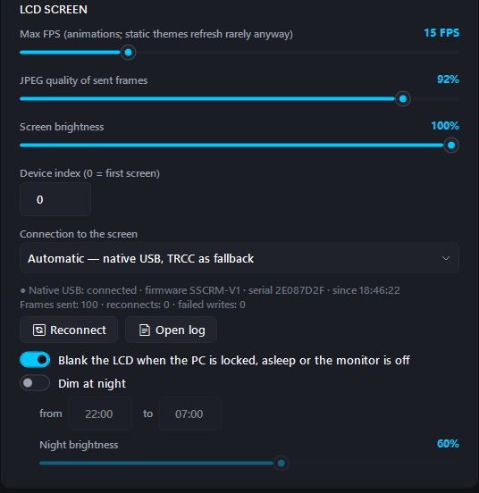

**Settings → LCD screen:**

- **Max FPS:** the frame rate for animations and videos. Static themes are only redrawn when a value changes, so they cost almost nothing whatever this says.
- **JPEG quality:** how frames are compressed for the screen. 85–95 % looks the same as the original.
- **Screen brightness:** applies right away. The panel has no backlight control, so frames are darkened before they're sent (Thermalright's own software does the same).
- **Connection to the screen:** *Automatic* uses the app's own USB connection and falls back to TRCC's; *Native USB only* or *Through TRCC* force one. Under it you see the connection: firmware, frames sent, reconnects, the last error, and **Reconnect** / **Open log**.
- **Blank the LCD when the PC is locked, asleep or the monitor is off.**
- **Dim at night:** a second brightness between two times.

 

---

## Interface theme and accent color

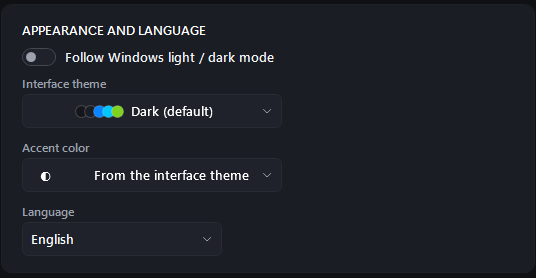

**Settings → Appearance and language** changes the look of the app itself (the LCD themes are separate).

- **Interface theme:** Dark, Light, OLED Black, Catppuccin (Mocha, Macchiato, Frappé, Latte), Nord, Dracula, Tokyo Night, Gruvbox Dark, Rosé Pine, Solarized Light. The list shows each one's colors; the window switches as soon as you pick.
- **Follow Windows light / dark mode:** choose one theme for light mode and one for dark mode, e.g. Solarized Light and Catppuccin Mocha. The app switches with Windows (Settings → Personalization → Colors).
- **Accent color:** the color of buttons, selections, sliders and switches, over any theme. It's adjusted to stay readable on light and dark themes.
- **Language:** English or Polski, switched live.

**Save settings** keeps your choice; **Discard changes** goes back.

 

---

## Starting with Windows and the tray

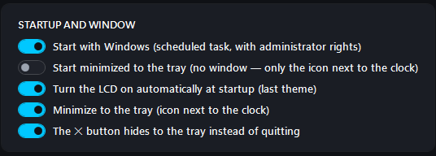

- **Start with Windows** uses a scheduled task with administrator rights, so Windows doesn't ask at every logon.
- **Start minimized to the tray:** only the tray icon, no window.
- **Turn the LCD on automatically at startup** shows the last theme right away.
- **Minimize to the tray** and **The ✕ button hides to the tray** keep the screen running in the background.

The tray icon's menu shows the window, starts or stops the screen, moves to the next playlist theme, toggles blanking and exits. Only one copy of the app runs: starting it again brings up the window of the one that's running.

---

## Keyboard shortcuts

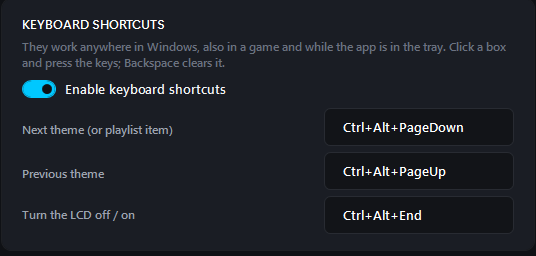

**Settings → Keyboard shortcuts** (off until you enable them) work anywhere in Windows, also in a game and while the app is in the tray:

| Action | Default |
|---|---|
| Next theme (or the next playlist item) | Ctrl+Alt+PageDown |
| Previous theme | Ctrl+Alt+PageUp |
| Turn the LCD off / on | Ctrl+Alt+End |

To change one, click its box and press the keys; Backspace clears it. A shortcut needs Ctrl, Alt or Win (F13–F24 may stand alone). With a single theme, next / previous go through the library in the order the category filter shows. If another program already uses a combination, the page says so. Shortcuts don't switch themes while the editor has unsaved changes.

---

## Updates

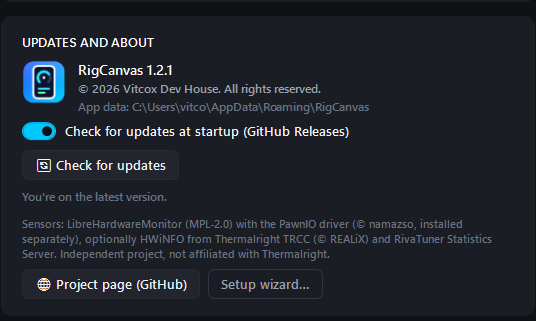

With **Check for updates at startup** on (**Settings → Updates and about**), the app looks for a new release on GitHub and offers to install it; **Check for updates** does it on demand. The update downloads the installer from the official releases and restarts the app. Your settings and themes stay.

The same page shows the version, where your data is, and **Setup wizard…** to run the first-start wizard again.

 

---

## Your data and backups

Everything the app stores is in `%AppData%\RigCanvas` (**Settings → Updates and about** shows the exact folder):

| Path | Contents |
|---|---|
| `settings.json` | All settings |
| `Themes\` | Your themes and the built-in ones (`.lcdtheme`), with `fonts\` and `assets\` |
| `Playlists\` | Saved playlists |
| `history.bin` | One average per minute for the last 24 hours, for long graphs |
| `weather-cache.json` | The last weather, shown during an outage of the weather service |
| `logs\app.log` | Diagnostics log (screen connection, power events, weather errors) |

To back up your setup, copy the whole folder while the app is closed (tray → **Exit**). To take a theme to another PC, **Export** it as a `.tlcd` package: it carries its pictures and fonts.

When you uninstall, the uninstaller asks whether to keep this folder.
